# Bidding Under Uncertainty and Budgets: A Multi-Agent Study of the IPL Player Auction

CS329 Foundations of AI: Multiagent Systems, final project.
Harshvarshan Masalge (24110196), Advait Andhale (24110039), Onkar Gaikwad (24110117), Shreyash Pandit (24110334).

**Report:** [`report/main.pdf`](report/main.pdf) (LaTeX source in [`report/`](report)).

We model the IPL player auction as a sequential, budget-constrained, common-value auction among the ten
franchises. The simulator runs on real data: Cricsheet ball-by-ball records (1,243 IPL matches), auction
results for 2018-2025, and the full 577-player list, purses and retentions of the **2025 mega auction**.
On top of it we implement and compare:

- naive, shading and winner's-curse-corrected (symmetric-equilibrium) bidders;
- a budget-aware **dynamic-programming** bidder based on a closed-form drop-out rule (Proposition 1, proved and checked numerically);
- **pacing** bidders, a pacing equilibrium found by best-response dynamics, **online dual pacing** and a **Q-learning** bidder;
- **team-specific values** through each team's best playing XI, solved exactly.

## How the review feedback was addressed

| Feedback | What we did | Where |
|---|---|---|
| 1. The money scale was fitted and checked on the same 2025 prices | The scale is fitted on the **2022** auction (robustness check: 2018-2024) and tested on 2025: R² = 0.53, Spearman 0.76 (the old in-sample fit gave 0.61). Opponent behaviour for validation is computed in the simulator, never tuned on 2025. | `experiments/fit_money_scale.py`, `experiments/validate_2025.py`, report Sec. 4.1, 5.1, 5.4 |
| 2. A player is not worth the same to every team | Utility = value of each team's **best XI** (≤4 overseas, ≥1 WK, ≥5 bowling options, ≥4 batters) + bench, solved exactly by DP. Need-aware agents bid their own marginal value. | `src/bestxi.py`, `experiments/fb2_team_specific.py`, Sec. 4.3, 5.6 |
| 3. Fix the prototype for tight budgets first | Real purses and retentions, the real minimum-price reserve per mandatory slot, an accelerated round plus mandatory fill instead of the "stop shading" hack, an ILP benchmark at realised prices, and two curse metrics plus a "bid cut by purse cap" share. Done and unit-tested before any RQ was run. | `src/sim.py`, `tests/`, Sec. 4.2, 5.2 |

## Main results

| Question | Result |
|---|---|
| RQ1: winner's curse | With slack purses, naive winners pay **1.23x** true value (σ = 0.3), rising with the number of teams (0.99 at n=4 to 1.23 at n=10). The equilibrium bid of Eq. (5) removes it (0.96x). With the **real 2025 purses** the curse is *masked*: prices fall to 0.83x value because 44% of winning bids are cut by the purse cap, yet the winners' estimates are still biased by +₹1.9 cr. |
| RQ2: budget-aware bidding | The DP bidder earns **1.6-4.4x** the utility of naive bidding. The gain is largest with tight purses (4.4x when all purses are halved). DP + Eq. (5) is best in 4 of 5 settings. Proposition 1 is optimal in 98% of 300 brute-forced states. |
| RQ3: pacing equilibrium | Best-response dynamics over pacing multipliers **cycle** (period 4) inside λ ∈ [1.5, 6]. The cycle average is an approximate equilibrium (ε = 14% of utility). League utility is 1,015 cr vs 320 cr when everyone bids naively. |
| RQ4: learning without an opponent model | Dual pacing recovers 3-28% and Q-learning −3 to 29% of the DP's gain. Q-learning plateaus at the pacing-equilibrium level (115 vs DP 150 cr for DC). |
| Validation vs real 2025 | The pacing equilibrium reproduces the 2025 price distribution best (KS 0.13 vs 0.23 naive; top price ≈ 31 cr vs real 27 cr). Player-level Spearman is 0.74. Simulated teams under-spend (450 vs 639 cr). |
| Feedback 2 | Mid-auction, the same star is worth **22% to 76%** of his common value depending on the team. Need-aware bidding helps **all 10 teams** (+7 to +42 cr) and best reproduces which roles each team bought. |
| Real-data check | Sold players under-performed our pre-auction prediction in the 2025 season by 1.36 ± 0.52 runs/match. Price premiums over the public model were not repaid on the field (slope 0.87 vs 23 if justified). |

### Figures

| | |
|---|---|
| 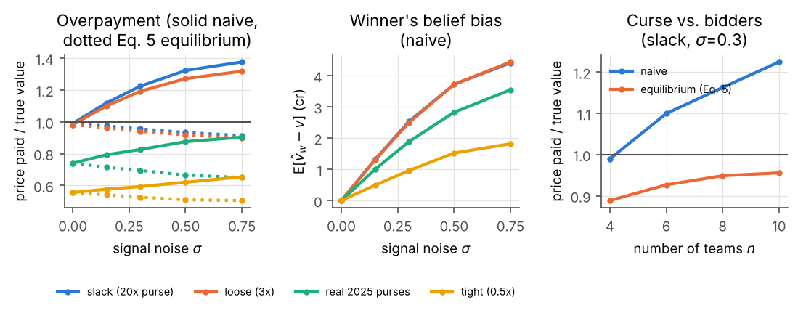 | 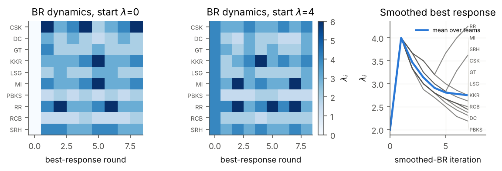 |
| RQ1: overpayment, belief bias, number of bidders | RQ3: best-response dynamics cycle; smoothed BR |
| 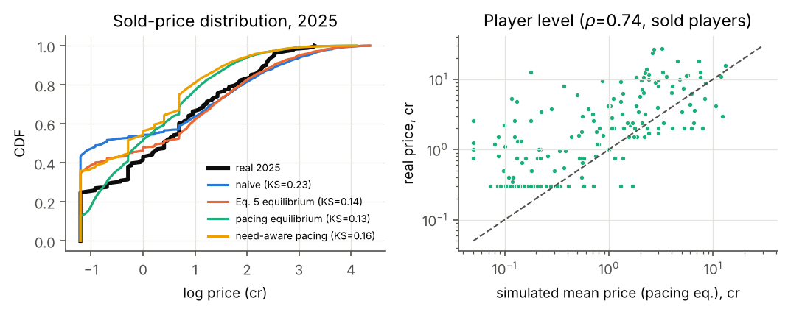 | 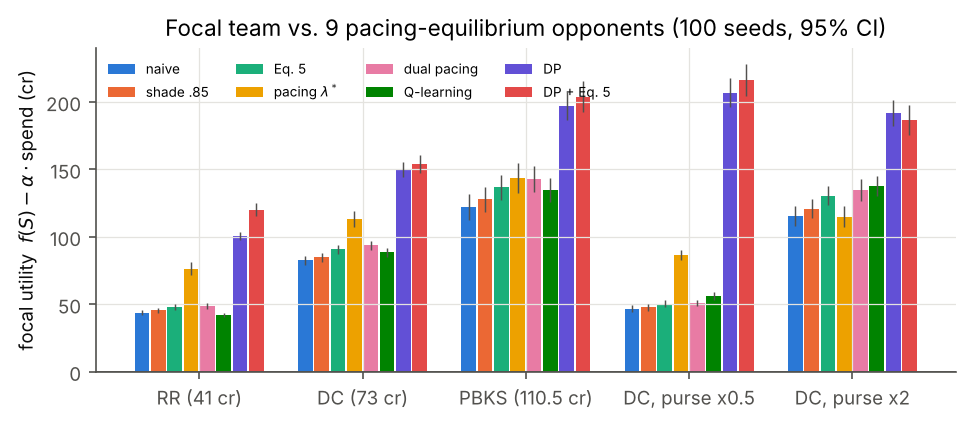 |
| Validation against the real 2025 auction | RQ2/RQ4: focal-team utilities |
| 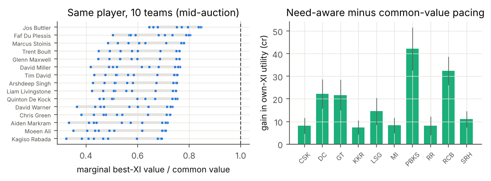 | 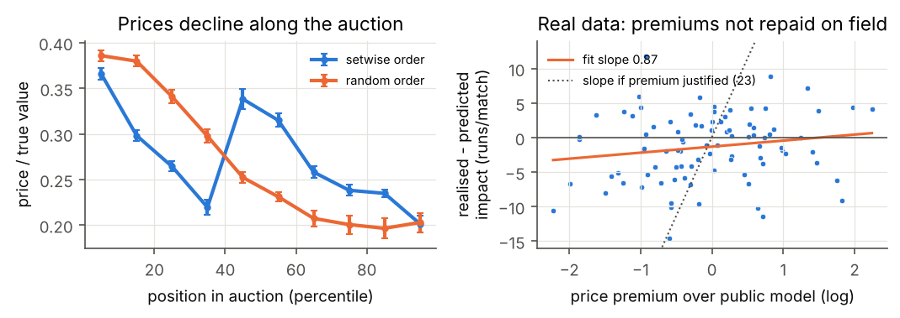 |
| Feedback 2: team-specific values | Declining prices; real-data test of the curse |

### Screenshots of the runs

Console output of the runs that produced the numbers in the report (`experiments/make_screenshots.py` renders `results/*.log`):

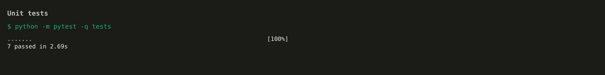
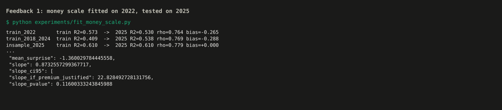
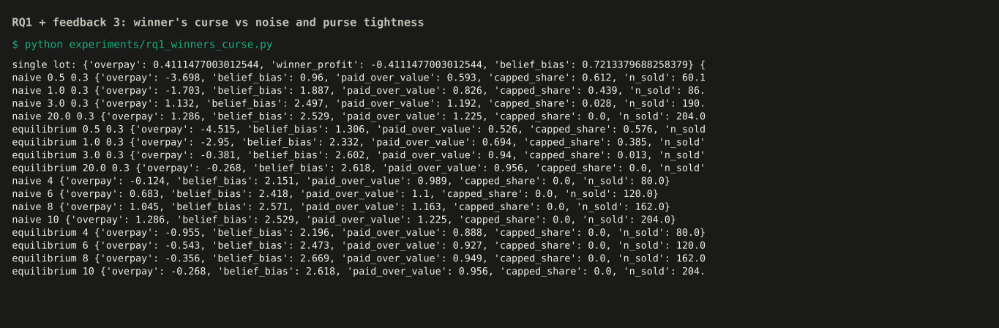
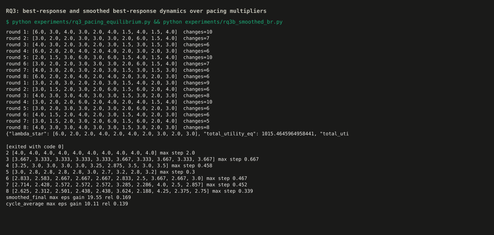
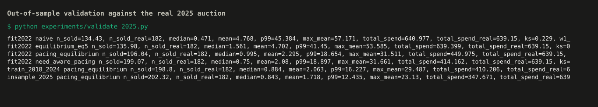
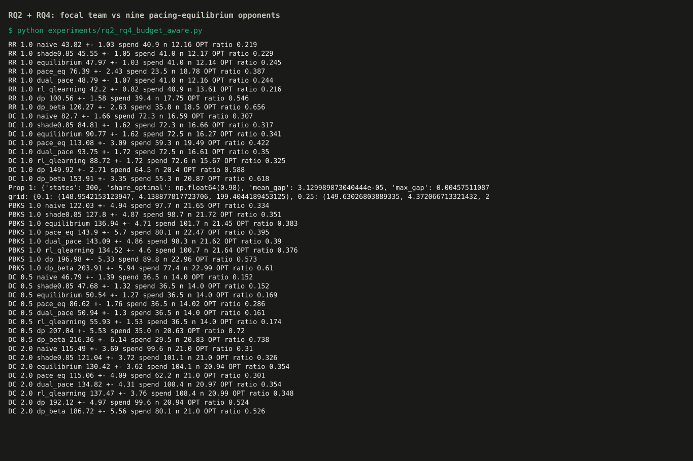
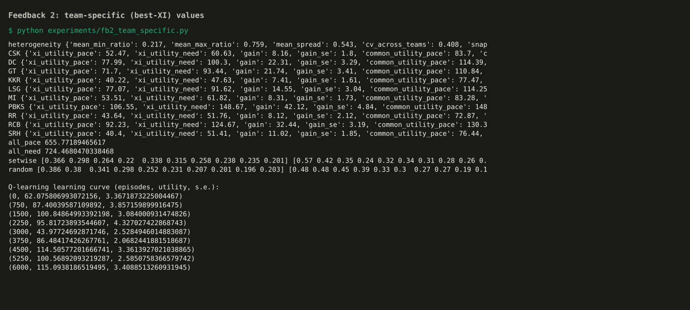

## Repository layout

```
src/
  parse_cricsheet.py   Cricsheet JSON -> one row per delivery
  auctions.py          auction lists, purses, name matching (surname + initial, alias table)
  value_model.py       per-ball impact, empirical-Bayes shrinkage (Eq. 11), realised season impact
  build_dataset.py     modelling tables with pre-auction features only (no look-ahead)
  build_retained.py    values of the 46 retained players
  teams.py             2025 purses and retained players
  sim.py               auction simulator, naive / shade / equilibrium / pacing / dual-pacing / need-aware agents,
                       curse metrics, hindsight ILP (Eq. 10)
  dp.py                pilot opponent model, backward induction (Eq. 6), drop-out rule (Prop. 1), DP agent
  rl.py                tabular Q-learning bidder
  bestxi.py            exact best-XI DP, incremental tracker, MILP check
experiments/           one script per research question + figures, tables, screenshots
results/               JSON results and console logs used by the report
figures/ screenshots/  generated images
report/                main.tex, arxiv.sty, references.bib, tables/ (generated), main.pdf
tests/                 pytest invariants
legacy/                the idea-review prototype (kept for comparison)
data/raw/              Cricsheet IPL JSON (zip), auction CSVs 2013-2026, 2025 mega-auction list
data/processed/        derived tables
```

## Reproducing

```bash
pip install -r requirements.txt
bash run_all.sh            # ~1.5-2 h on 2 cores; regenerates results/, figures/, report/tables/ and report/main.pdf
python -m pytest -q tests  # 7 tests, ~3 s
```

Every number in the report's tables is written by `experiments/make_tables.py` from `results/*.json`.
Experiments use fixed seeds and common random numbers, so a rerun gives the same numbers.

## Data sources

- Cricsheet IPL ball-by-ball JSON (v1.2.0), https://cricsheet.org
- IPL auction datasets 2013-2026 and the 2025 mega-auction list (Kaggle).
- The Kaggle "IPL Complete Dataset 2008-2025 (Enhanced Edition)" was inspected and **not used**: its player names are synthetic.

